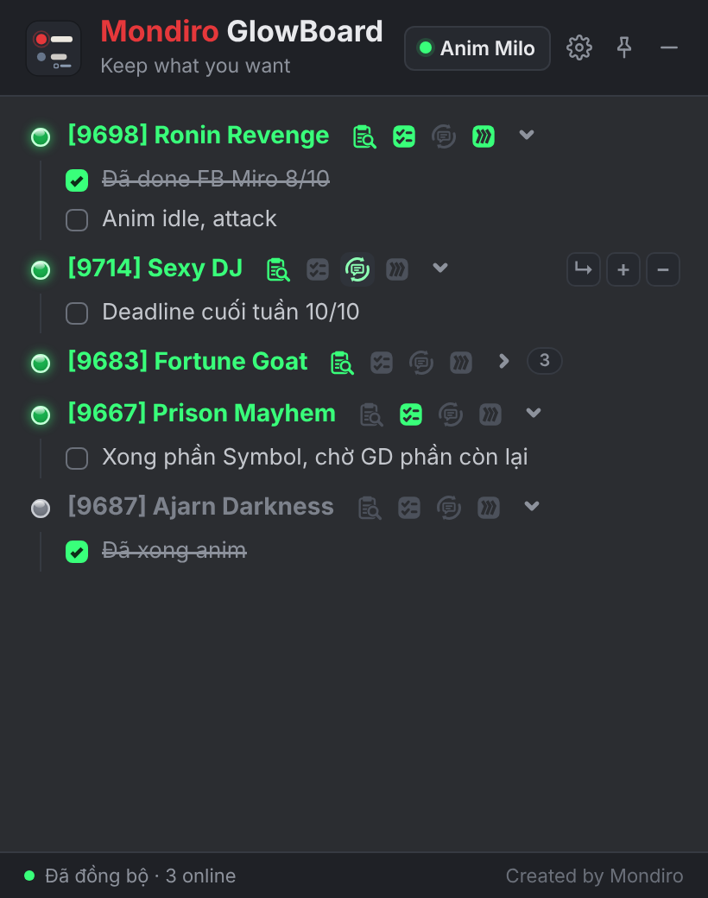

# Mondiro GlowBoard

Board ghi chú dạng widget nằm trên desktop Windows, chạy ở khay hệ thống (system tray).



## Tải về & chạy
1. Vào trang **Releases** của repo, tải `GlowBoard_Windows_x64.zip` của bản mới nhất, giải nén ra một thư mục không cần quyền admin (ví dụ `D:\Apps\GlowBoard`, **không** để trong `Program Files`).
2. Chạy `GlowBoard.exe`. App cần **Microsoft Edge WebView2 Runtime**: Windows 11 có sẵn; nếu máy bạn thiếu, app sẽ hỏi và mở trang tải về.
3. Muốn GlowBoard tự bật cùng Windows: chuột phải icon ở khay hệ thống → **Khởi động cùng Windows**.


## Board của team (đồng bộ online)
- Lần đầu mở app: nhập **mã team** (do quản lý gửi) và **tên hiển thị**. Từ đó app tự vào lại team mỗi lần mở.
- Mọi người trong team thấy thay đổi của nhau gần như ngay lập tức. Mất mạng vẫn ghi được, có mạng lại tự đồng bộ.
- Rê chuột vào một dòng ~0.7 giây để xem **"Sửa bởi … · … trước"**.
- Tên team nằm ở góc trái thanh dưới cùng. Chấm nhỏ cạnh tên team: xanh = đã đồng bộ, xám = đang offline.
- **Bấm vào tên team** để xem danh sách thành viên: tên, ai đang online (đang mở GlowBoard), ai offline và hoạt động lần cuối khi nào. Tên trùng nhau được gộp thành 1 dòng; Admin có nút **×** để xoá các dòng offline thừa (máy / phiên cũ).
- **Thông báo**: khi người khác thay đổi board, máy bạn hiện thông báo Windows (gom lại, chỉ báo sau khi đã yên 15 giây không có thay đổi mới). Click vào thông báo để mở board. Tắt / bật: khay hệ thống → **Thông báo khi team thay đổi**.
- Khay hệ thống → **Rời team / nhập mã khác**.

### Admin (quản lý)
- Khay hệ thống → **Chế độ Admin…** (hoặc link "Đăng nhập Admin" ở màn hình nhập mã) → đăng nhập email + mật khẩu Admin.
- **＋ Tạo team**: đặt tên, app tự sinh mã (VD `DRAGON-K6EEAB`) và copy sẵn để gửi cho team.
- **Mở board**: xem / sửa board của team đó (nút ← để quay lại danh sách).
- **Đổi mã**: mã cũ hết hiệu lực ngay, máy đang dùng mã cũ phải nhập mã mới.
- **Khóa team / Mở khóa**: tạm ngưng cả team truy cập board, dữ liệu vẫn giữ nguyên.
- **Nhập board cũ**: đưa board cá nhân của bản trước (trên máy Admin) vào board của team.
- Luật bảo mật nằm ở `firestore.rules` – dán vào Firebase Console → Firestore → **Rules** → **Publish** mỗi khi file này thay đổi.

## Cách dùng board
| Thao tác | Cách làm |
|---|---|
| Bật / tắt đầu mục | Click vào chấm tròn (xanh lá nhấp nháy = bật, xám = tắt, chữ cũng chuyển xám) |
| Đổi thứ tự | Nhấn giữ vào dòng rồi kéo lên/xuống (dòng đang gõ chữ: giữ ~0.3 giây rồi kéo) |
| Gõ chữ | Click vào dòng. Đầu mục in đậm màu xanh dạ quang, mục con chữ trắng thường |
| Thêm / xoá dòng | Rê chuột vào dòng → nút **+** / **−** ở cuối dòng (xoá sẽ hỏi lại). Board trống: nút **＋ Thêm đầu mục** |
| Thêm mục con (có ô check) | Nút **↳** ở cuối dòng đầu mục, hoặc nút **+** trên mục con. Tick ô check → gạch ngang chữ |
| Gõ xong mục con | **Enter** để kết thúc gõ chữ (không xuống dòng) |
| Tag đỏ / vàng cho mục con | Rê chuột vào mục con → cờ đỏ (in đậm, chữ đỏ) hoặc cờ vàng (in đậm, chữ vàng, tự thêm "Quản file:" phía trước – bỏ tag thì tự xoá); ẩn ô check. Mỗi mục 1 tag, bấm lại để bỏ |
| Thu gọn / mở mục con | Mũi tên **⌄ / ›** ở sau các nút link của đầu mục (lưu riêng trên máy bạn; khi thu gọn sẽ hiện số mục con) |
| Nút link sau chữ đầu mục | **click** = mở link, **double click** = chèn / sửa link (nút sáng khi đã có link) |
| Config các nút link | Nút ⚙ ở thanh dưới cùng: nhấn giữ & kéo để đổi thứ tự (các dòng tự trượt đổi chỗ), thêm nút mới với icon PNG, sửa tooltip, ẩn / hiện, xoá (kể cả 4 nút mặc định – có nút "Khôi phục nút mặc định"). Áp dụng chung cả team |
| Dòng mới | `Enter` ở đầu mục: thêm đầu mục mới · xuống dòng trong cùng mục: `Shift+Enter` |
| Đổi cấp | `Tab`: đầu mục → mục con · `Shift+Tab`: mục con → đầu mục |
| Di chuyển / mở rộng board | Kéo thanh dưới cùng (chỗ trống) · kéo các cạnh viền |
| Kiểm tra cập nhật | Nút ⟳ cạnh ⚙ ở thanh dưới cùng (xanh = đã là bản mới nhất, nhấp nháy xanh = có bản mới, bấm để cài) |
| Luôn nằm trên cùng | Nút ghim 📌 ở thanh dưới cùng, hoặc khay hệ thống → **Luôn nằm trên cùng** |
| Hiện board lên trên | Click icon ở khay hệ thống (board tự lùi xuống dưới khi bạn click ra chỗ khác) |

## Overview – tổng quan task từ Google Sheet

Nút **▦ Overview** ở thanh dưới cùng (cạnh ⚙) mở **cửa sổ Overview rời**: cửa sổ Windows bình thường, có nút phóng to / thu nhỏ, kéo giãn tuỳ ý, nhớ vị trí & kích thước. Cửa sổ rộng thì các file tự chia nhiều cột. Đọc các file Google Sheet trong folder Drive của team.

- Mỗi file sheet = 1 mục lớn: tên file, ô chọn **tab** (mặc định tab ngoài cùng bên trái), số task đã xong / tổng và thanh tiến độ.
- Dưới mỗi file là từng người (cột **Assignee**): **Đang** = WIP · **Xong** = Done · **Còn** = To-do, N/A, ô trống · số xám = tổng task. **Reject** không được đếm.
- Bấm vào tên người để xem danh sách task (lấy dòng đầu ở cột **Miêu tả**): ● đang làm · ○ còn lại · ✓ đã xong.
- Bấm icon sheet xanh để mở file · bấm tên file để thu gọn. Dữ liệu tự cập nhật khoảng 1–2 phút sau khi sheet được sửa.
- **Refresh**: bắt script đọc lại toàn bộ file ở lần chạy kế tiếp (tối đa ~1 phút), không đợi Drive báo file đã sửa.
- **Giữ & kéo** tên file để đổi thứ tự ưu tiên các dự án (các file khác tự trượt chỗ). Chung cho cả team.
- Ô trạng thái **Active / Close** cạnh tên file: Close = dự án đã đóng, chuyển xám và ẩn danh sách bên dưới. Chung cho cả team.
- Dòng có ô Status trống và dòng tiêu đề lặp lại (Assignee / Status) không được đếm.
- Tab đã chọn và mục thu gọn được nhớ riêng trên máy bạn.

**Kết nối lần đầu (1 người làm cho cả team, người đó cần quyền xem folder Drive):**
Script chạy ngầm bằng tài khoản Google của người cài, mỗi phút đọc file vừa sửa và gửi lên board của team – không cần Deploy, không cần quyền "Anyone" (dùng được với tài khoản công ty).
1. Mở Overview → kiểm tra link folder → bấm **Copy script** (mẫu nằm ở `apps-script/GlowBoard_Overview.gs`, app tự điền folder + mã team).
2. Vào script.google.com → **New project** → xoá code mẫu → dán → lưu.
3. Ô chọn hàm trên thanh công cụ chọn **setup** → **▶ Run** → **Review permissions** → chọn tài khoản → **Allow**.
4. Chờ 10–30 giây là cả team thấy dữ liệu.
   Đổi folder / Admin đổi mã team: bấm **<>** trên thanh Overview → copy script mới → dán đè → chạy lại **setup**. Tắt hẳn: trong Apps Script → Triggers (đồng hồ) → xoá trigger `sync`.

## Tự cập nhật
Mỗi lần push thay đổi trong `src/` lên GitHub, GitHub Actions (`.github/workflows/release.yml`) tự build và tạo một **Release** mới (`v1.0.<số lần build>`).
App kiểm tra bản mới 30 giây sau khi mở và mỗi 2 giờ. Khi có bản mới, app tải sẵn và tự khởi động lại lúc bạn không thao tác trên board.
Chuột phải icon ở khay hệ thống → **Kiểm tra cập nhật** để cập nhật ngay.

Repo cần để **public** để app tải được bản mới.

## Build từ source
Cần .NET SDK 8 (build được trên Windows hoặc Linux):
```
cd src/GlowBoard
dotnet build -c Release
```
Kết quả nằm ở `src/GlowBoard/bin/Release/net48/`. App chạy trên .NET Framework 4.8 (có sẵn trong Windows 10/11) nên không cần cài thêm gì.

- `Web/index.html`: toàn bộ giao diện board (HTML/CSS/JS), được nhúng vào exe
- `Web/fb.js`: thư viện Firebase đã gói sẵn (tạo lại: `cd src/GlowBoard/WebSrc && npm install && npm run build`)
- `firestore.rules`: luật bảo mật Firestore
- `MainForm.cs`: cửa sổ widget, khay hệ thống, lưu/mở file
- `Assets/`: icon app

Created by Mondiro
